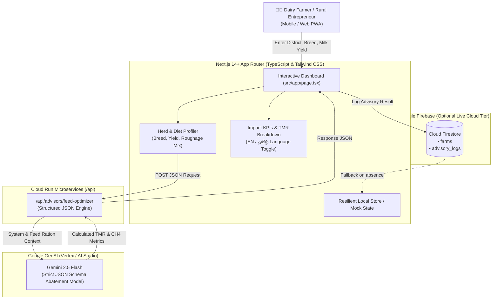

# SmartDairy AI: Methane Reduction & Feed Optimization Platform

> **AI Builder Cup 2026** — *Track: Sustainability & Social Impact*  
> Inspired by the **Climate Smart Dairy Entrepreneurship Programme** (Kumaraguru Institutions & Environmental Defense Fund - EDF).  
> 🌐 **Live Cloud Run Service:** [https://smartdairy-ai-954553665284.asia-south1.run.app](https://smartdairy-ai-954553665284.asia-south1.run.app)

---

## 🎯 Executive Summary

Enteric fermentation from dairy cattle is one of the single largest agricultural sources of atmospheric methane ($CH_4$), a short-lived climate pollutant over 80 times more potent than $CO_2$ over a 20-year timeline. In rural Tamil Nadu, traditional feeding practices reliant on untreated paddy straw and imbalanced roughage lead to high methanogenesis, low feed conversion efficiency, and high production costs for smallholder farmers.

**SmartDairy AI** digitizes field research from the Kumaraguru & EDF initiative into an AI-powered advisory system. Powered by **Google Gemini 2.5 Flash** and deployed on **Google Cloud Run**, it formulates precision **Total Mixed Rations (TMR)** using locally available Tamil Nadu crop residues, reducing enteric methane intensity by **18% to 28%**, boosting daily milk yields, and putting extra income into rural farmers' pockets.

---

## 🏛️ System Architecture



---

## ✨ Key Features

1. **Precision Enteric Methane Abatement**:
   - Calculates enteric methane emission intensity reductions (18% – 28%) using localized rations.
   - Promotes silage (CO-4 / CO-5 Super Napier), chaffed sorghum stover, TANUVAS mineral mixtures, and rumen bypass fats.
2. **Bilingual Advisory (English & தமிழ்)**:
   - Provides clear, actionable steps in both English and Tamil so rural farmers can immediately implement instructions.
   - Integrated text-to-speech audio reader.
3. **Graceful Zero-Crash Fallback**:
   - Seamlessly falls back to localized scientific calculation presets and pre-seeded Tamil Nadu farms (Coimbatore, Namakkal, Salem, Erode) if API keys or Firebase credentials are not provided.
4. **Cloud Run Production-Ready**:
   - Multi-stage Docker container outputting Next.js standalone binary listening on port `8080`.
   - `cloudbuild.yaml` for CI/CD deployments.

---

## 🚀 Quick Start (Local Development)

### 1. Prerequisites
- Node.js 18+ or 20+ (Node 20+ recommended)
- npm or yarn

### 2. Clone and Install Dependencies
```bash
git clone <repo-url>
cd smartdairy-ai
npm install
```

### 3. Configure Environment Variables
Copy `.env.example` to `.env.local`:
```bash
cp .env.example .env.local
```

Fill in your API keys (optional — application includes built-in offline fallback if left blank):
```env
# Gemini API Key (get from https://aistudio.google.com/)
GEMINI_API_KEY=your_gemini_api_key_here

# Firebase Configuration (Optional)
NEXT_PUBLIC_FIREBASE_API_KEY=your_firebase_api_key
NEXT_PUBLIC_FIREBASE_AUTH_DOMAIN=your-project.firebaseapp.com
NEXT_PUBLIC_FIREBASE_PROJECT_ID=your-project-id
NEXT_PUBLIC_FIREBASE_STORAGE_BUCKET=your-project.appspot.com
NEXT_PUBLIC_FIREBASE_MESSAGING_SENDER_ID=your_sender_id
NEXT_PUBLIC_FIREBASE_APP_ID=your_app_id
```

### 4. Run Development Server
```bash
npm run dev
```
Open [http://localhost:3000](http://localhost:3000) to view the application.

---

## 🐳 Docker & Google Cloud Run Deployment

### Option A: Local Docker Build & Run
```bash
# Build the container image
docker build -t smartdairy-ai:latest .

# Run on port 8080
docker run -p 8080:8080 -e GEMINI_API_KEY="your_api_key" smartdairy-ai:latest
```
Visit [http://localhost:8080](http://localhost:8080).

### Option B: Deploy to Google Cloud Run via Google Cloud SDK
```bash
# Authenticate and set project
gcloud auth login
gcloud config set project YOUR_PROJECT_ID

# Deploy directly from source
gcloud run deploy smartdairy-ai \
  --source . \
  --region asia-south1 \
  --platform managed \
  --allow-unauthenticated \
  --port 8080 \
  --set-env-vars GEMINI_API_KEY="your_gemini_api_key"
```

### Option C: Cloud Build Automated Trigger
```bash
gcloud builds submit --config=cloudbuild.yaml
```

---

## 🧪 Tech Stack Summary

| Layer | Technology |
|---|---|
| **Framework** | Next.js 14+ (App Router, Standalone Mode) |
| **Language** | TypeScript |
| **Styling** | Tailwind CSS (Emerald & Slate Sustainability Theme) |
| **AI / LLM** | `@google/genai` (Gemini 2.5 Flash) with JSON Schema |
| **Icons & Animations** | Lucide React, Framer Motion |
| **Database** | Firebase Firestore (with local in-memory fallback) |
| **Container & Cloud** | Docker, Google Cloud Run, Google Cloud Build |

---

## 🤝 Acknowledgments
- **Kumaraguru Institutions & Environmental Defense Fund (EDF)** for their ground research under the *Climate Smart Dairy Entrepreneurship Programme* in Tamil Nadu.
- **Tamil Nadu Veterinary and Animal Sciences University (TANUVAS)** for dairy nutrition standards and mineral premix guidelines.
