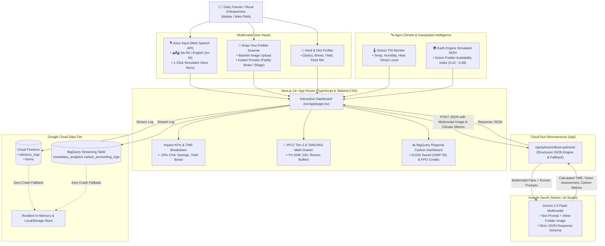

# SmartDairy AI: Methane Reduction & Feed Optimization Platform

> **AI Builder Cup 2026** — *Track: Sustainability & Social Impact*  
> Inspired by the **Climate Smart Dairy Entrepreneurship Programme** (Kumaraguru Institutions & Environmental Defense Fund - EDF).  
> 🌐 **Live Cloud Run Service:** [https://smartdairy-ai-954553665284.asia-south1.run.app](https://smartdairy-ai-954553665284.asia-south1.run.app)

---

## 🎯 Executive Summary

Enteric fermentation from dairy cattle is one of the single largest agricultural sources of atmospheric methane ($CH_4$), a short-lived climate pollutant over 80 times more potent than $CO_2$ over a 20-year timeline (GWP-20 = 84). In rural Tamil Nadu, traditional feeding practices reliant on un-chaffed paddy straw and unbalanced roughage lead to high methanogenesis, low feed conversion efficiency, and high production costs for smallholder farmers.

**SmartDairy AI** digitizes field research from the Kumaraguru & EDF initiative into an AI-powered advisory system. Powered by **Google Gemini 2.5 Flash**, **Multimodal Vision AI**, **Earth Engine Agro-Climatic Intelligence**, and **BigQuery Carbon Accounting**, it formulates precision **Total Mixed Rations (TMR)** using locally available Tamil Nadu crop residues, reducing enteric methane intensity by **18% to 28%**, boosting daily milk yields, and aggregating voluntary carbon credit revenues for rural Farmer Producer Organizations (FPOs).

---

## 🏛️ System Architecture



---

## 🚀 5 Core Feature Upgrades

### 1. 📸 Multimodal "Snap-Your-Fodder" Vision Scanner (`gemini-2.5-flash`)
- Allows farmers to upload photos of their roughages and straws to inspect chop length and lignification.
- Evaluates Acid Detergent Fiber (ADF) risk, chaffing status (un-chaffed vs. optimal 2–3 cm chop), and gives actionable feeding instructions.
- **Judges Demo Presets**: Includes 1-click synthetic presets for *Untreated Long Paddy Straw* and *Chaffed CO-4 Green Napier Silage* to test Vision AI without requiring a photo file.

### 2. 🌡️ Geospatial Climate & Heat-Stress (THI) Intelligence (Earth Engine Context)
- Dynamic agro-climatic lookup for 6 major Tamil Nadu dairy districts: **Coimbatore, Salem, Erode, Tiruppur, Namakkal, Dindigul**.
- Evaluates ambient Temperature, Relative Humidity, **Temperature-Humidity Index (THI)**, and **Satellite NDVI Green Fodder Availability Index** (simulating Earth Engine vegetation scores).
- Automatically triggers heat stress dietary mitigations when $\text{THI} \ge 78$ (e.g. adding 100–150g Sodium Bicarbonate buffer and rumen bypass fat to prevent Sub-Acute Ruminal Acidosis and milk fat depression).

### 3. 🎙️ Bilingual Voice Input ("Speak to SmartDairy" in தமிழ் & English)
- Integrated Web Speech API supporting Tamil (`ta-IN`) and Indian English (`en-IN`).
- **Judges Quick Voice Simulator**: Features a 1-click demo button running a natural Tamil voice command:
  > *"என்னிடம் ஈரோட்டில் 4 கலப்பின ஜெர்சி மாடுகள் உள்ளன, தினமும் 12 லிட்டர் பால் கறக்கிறது, வைக்கோல் மற்றும் கடலை புண்ணாக்கு போடுகிறேன்"*
  and automatically populates District, Breed, Herd Size, Milk Yield, and Feed selections!
- Audio text-to-speech advisory reader (`window.speechSynthesis`) in Tamil and English.

### 4. 📊 BigQuery Regional Carbon Credit & FPO Impact Aggregator
- Formats every optimization run into an **IPCC Tier-2 carbon accounting schema** (`smartdairy_analytics.carbon_accounting_logs`).
- Aggregates cooperative impact across Tamil Nadu dairy clusters:
  1. **Total Enteric $CH_4$ Abated (kg/year)**
  2. **Carbon Equivalent Saved ($tCO_2e$/year — GWP-20 = 84x)**
  3. **Estimated Voluntary Carbon Credit Revenue (₹ INR/year for Farmer FPOs @ $18/tCO2e)**
  4. **District-wise Methane Intensity Leaderboard** with live breakdown across Coimbatore, Salem, Erode, Namakkal, Tiruppur, and Dindigul.

### 5. 🔬 Scientific Explainability Modal (IPCC Tier-2 & TANUVAS Rumen Model)
- Transparent collapsible drawer breaking down the exact scientific equations grounding the AI:
  - IPCC Tier-2 Enteric Fermentation: $\text{CH}_4\text{ (kg/day)} = \frac{\text{GEI} \times (Y_m / 100)}{55.65}$
  - Methane Conversion Factor ($Y_m$) shifting from untreated paddy straw ($Y_m \approx 6.5\%$) down to optimized TMR ($Y_m \approx 4.8\%$).
  - TANUVAS Rumen Buffer Chemistry: $\text{NaHCO}_3 + \text{H}^+ \rightarrow \text{Na}^+ + \text{H}_2\text{O} + \text{CO}_2 \uparrow$ maintaining rumen $\text{pH} > 6.2$.

---

## 🛡️ 100% Zero-Crash Local / Offline Fallback

The platform guarantees zero downtime during evaluation:
- If `GEMINI_API_KEY` is absent or rate-limited, the system seamlessly serves deterministic scientific calculation presets based on Tamil Nadu Veterinary and Animal Sciences University (TANUVAS) standards.
- If Firebase or GCP BigQuery credentials are not configured, state is maintained in-memory and mirrored to `localStorage`.

---

## 🚀 Quick Start (Local Development)

### 1. Prerequisites
- Node.js 18+ or 20+ (Node 20+ recommended)
- npm

### 2. Clone and Install Dependencies
```bash
git clone <repo-url>
cd smartdairy-ai
npm install
```

### 3. Configure Environment Variables (Optional)
Copy `.env.example` to `.env.local`:
```bash
cp .env.example .env.local
```

```env
# Google Gemini API Key (https://aistudio.google.com/)
GEMINI_API_KEY=your_gemini_api_key_here

# Firebase Configuration (Optional)
NEXT_PUBLIC_FIREBASE_API_KEY=your_firebase_api_key
NEXT_PUBLIC_FIREBASE_AUTH_DOMAIN=your-project.firebaseapp.com
NEXT_PUBLIC_FIREBASE_PROJECT_ID=your-project-id
NEXT_PUBLIC_FIREBASE_STORAGE_BUCKET=your-project.appspot.com
NEXT_PUBLIC_FIREBASE_MESSAGING_SENDER_ID=your_sender_id
NEXT_PUBLIC_FIREBASE_APP_ID=your_app_id
```

### 4. Run Development Server
```bash
npm run dev
```
Open [http://localhost:3000](http://localhost:3000) to view the application.

---

## 🐳 Docker & Google Cloud Run Deployment

### Option A: Local Docker Build & Run
```bash
# Build the container image
docker build -t smartdairy-ai:latest .

# Run on port 8080
docker run -p 8080:8080 -e GEMINI_API_KEY="your_api_key" smartdairy-ai:latest
```
Visit [http://localhost:8080](http://localhost:8080).

### Option B: Deploy to Google Cloud Run
```bash
gcloud run deploy smartdairy-ai \
  --source . \
  --region asia-south1 \
  --platform managed \
  --allow-unauthenticated \
  --port 8080 \
  --set-env-vars GEMINI_API_KEY="your_gemini_api_key"
```

---

## 🧪 Tech Stack Summary

| Layer | Technology |
|---|---|
| **Framework** | Next.js 14+ (App Router, Standalone Mode) |
| **Language** | TypeScript |
| **Styling** | Tailwind CSS (Emerald & Slate Sustainability Theme) |
| **AI / Multimodal** | `@google/genai` (Gemini 2.5 Flash) with Multimodal Vision & JSON Schema |
| **Voice AI** | Browser Web Speech API (`SpeechRecognition` & `SpeechSynthesis`) |
| **Climate Context** | Temperature-Humidity Index (THI) & Earth Engine NDVI Simulation |
| **Carbon Analytics** | IPCC Tier-2 Accounting & BigQuery Regional Aggregator |
| **Database** | Firebase Firestore (with local in-memory fallback) |
| **Container & Cloud** | Docker, Google Cloud Run, Google Cloud Build |

---

## 🤝 Acknowledgments
- **Kumaraguru Institutions & Environmental Defense Fund (EDF)** for their ground research under the *Climate Smart Dairy Entrepreneurship Programme* in Tamil Nadu.
- **Tamil Nadu Veterinary and Animal Sciences University (TANUVAS)** for dairy nutrition standards, mineral premix guidelines, and rumen buffer formulations.
